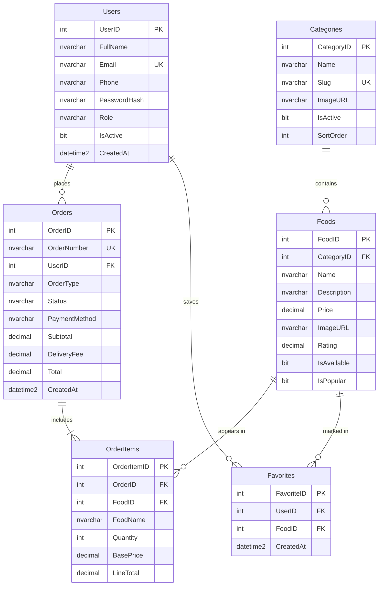

# Entity-Relationship Diagram (ERD) — CeylonBiteDB

## 📊 Visual ER Diagram

---

## 📝 Relationship Explanations

1. **`Users` 1 → Many `Orders`**:
   - A single customer can place multiple orders over time.
   - Each order is linked to exactly one user via `Orders.UserID`.

2. **`Orders` 1 → Many `OrderItems`**:
   - An order contains one or more food line items.
   - Each line item belongs to a specific order via `OrderItems.OrderID`.

3. **`Foods` 1 → Many `OrderItems`**:
   - A menu dish can appear in many order line items across different customer orders.
   - Linked via `OrderItems.FoodID`.

4. **`Categories` 1 → Many `Foods`**:
   - Each food category (e.g. Burgers) contains multiple food items.
   - Linked via `Foods.CategoryID`.

5. **`Users` 1 → Many `Favorites`**:
   - A user can favorite multiple dishes.
   - Linked via `Favorites.UserID`.

6. **`Foods` 1 → Many `Favorites`**:
   - A food item can be favorited by multiple users.
   - Enforced by a unique composite constraint `(UserID, FoodID)`.
